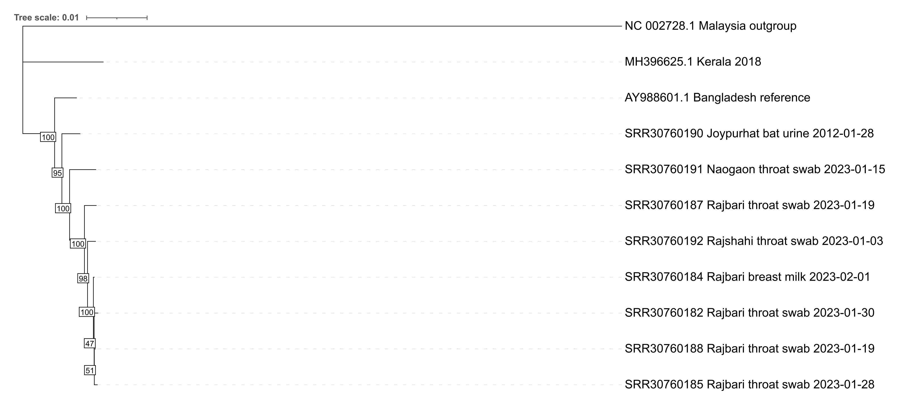
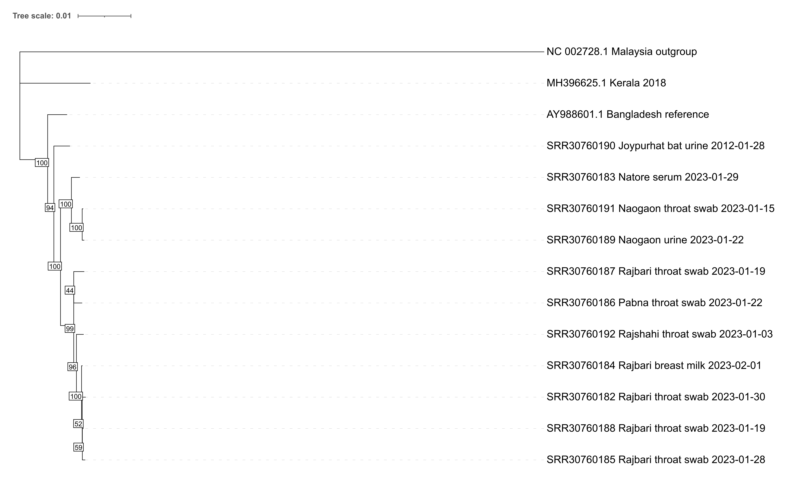

# Nipah Virus Genomes from Public Nanopore Data

I built this to learn NGS analysis on real data. It takes 11 public Oxford Nanopore runs of Nipah virus from Bangladesh and rebuilds one genome from each. It then compares those genomes with the ones the original authors published, and puts them on a tree next to a Kerala 2018 genome and a Malaysian one.

Nothing here is new biology. It is a practice project and a reproduction check, and where my numbers disagree with the paper I say so below.

## Data

The reads come from Rahman et al. 2025 (full reference at the bottom). The authors amplified the genome with a multiplex PCR of about 60 amplicons, each around 400 bp, and sequenced the pool on a MinION.

- Reads: BioProject PRJNA1163683, runs SRR30760182 to SRR30760192. That is 142.04 M bases from ten human samples (collected January to early February 2023) and one bat roost urine sample (2012).
- Genomes for comparison: the authors' own consensus genomes, PP981676 to PP981683 and PQ368168 to PQ368170.
- References: AY988601 (Bangladesh, 2004), MH396625 (Kerala, 2018) and NC_002728.1 (Malaysia).

## What I did

| Step | Tool | Settings |
|---|---|---|
| Download | sra-tools, NCBI E-utilities | reads with fasterq-dump, genomes with efetch |
| Filter reads | chopper | mean quality 7 or higher, length 200 or more. This removed 0.05 to 0.42% of reads per run |
| Map | minimap2 | -ax map-ont, against AY988601 |
| Call variants | bcftools | haploid, SNPs only, base quality 7 or higher. Then depth 20 or more and allele fraction 0.7 or more |
| Consensus | bcftools consensus | any position with fewer than 20 reads becomes N |
| Align and tree | MAFFT, IQ-TREE | TIM2+F+G4 (picked by BIC), 1,000 ultrafast bootstraps, seed 12345, rooted on NC_002728.1 |
| Compare | MAFFT, a short Python script | counts positions that differ, where both genomes have A, C, G or T |

I tried both the Bangladesh and the Kerala reference on SRR30760192. AY988601 gave fewer mismatches (9.85% against 10.78%), so every sample was mapped to it. Most of either number is probably read noise. That run's mean read quality is about Q10.6, which is roughly 9% error per base.
bcftools mpileup stops at 250 reads per position unless told otherwise, and these runs have far more, so I raised the cap to 10,000.

The main tree uses the eight genomes that are at least 60% called, plus the three references. A second tree uses all 11.
SRR30760186 is stored as two files, and the second one is a piece of the first in all 1,598 read pairs. I used the plain reads plus the first file only, so nothing is counted twice.

## Results per sample

"Called" means the share of the genome covered by at least 20 reads.

| Run | Source | Mean depth | Called (%) | SNPs vs AY988601 |
|---|---|---|---|---|
| SRR30760182 | Rajbari, throat swab | 834.9 | 79.1 | 142 |
| SRR30760183 | Natore, serum | 180.6 | 50.9 | 88 |
| SRR30760184 | Rajbari, breast milk | 1130.6 | 97.9 | 179 |
| SRR30760185 | Rajbari, throat swab | 680.9 | 77.3 | 124 |
| SRR30760186 | Pabna, throat swab | 24.8 | 17.8 | 31 |
| SRR30760187 | Rajbari, throat swab | 858.3 | 96.6 | 181 |
| SRR30760188 | Rajbari, throat swab | 774.4 | 92.5 | 160 |
| SRR30760189 | Naogaon, urine | 115.1 | 40.6 | 75 |
| SRR30760190 | Joypurhat, bat roost urine | 393.1 | 66.9 | 90 |
| SRR30760191 | Naogaon, throat swab | 455.4 | 83.8 | 157 |
| SRR30760192 | Rajshahi, throat swab | 714.7 | 93.0 | 169 |

Four genomes are at least 90% called: 184, 187, 192 and 188. The rest have long runs of N, and 186 is mostly N.

For SRR30760192 the SNP count barely moves when the allele fraction cutoff goes from 0.5 to 0.7 at depth 20 or more (172, 172, 169). It drops to 155 at 0.8 and 115 at 0.9, which is why I stopped at 0.7.

In nine samples the SNP count is about 1% of the called bases (0.95 to 1.03%). The other two, 185 and 190, are lower at 0.88% and 0.74%.

## Against the published genomes

Each of my genomes differs from its published partner at 2 to 12 positions. In total that is 73 differences out of 145,356 compared positions, about 0.05%. I matched each run to the paper's sample by sample type and read count. The matching published genome was the closest one, or tied for closest, in all 11 cases. The ties are with relatives from the same outbreak cluster or the same patient. Mean depth is within about 2% of the paper's Table 1 for nine samples. The full table is in results/published_comparison.tsv.

## Trees

Eight genomes plus the three references. Support values are ultrafast bootstrap. The two lowest (47 and 51) are inside the Rajbari cluster.

All 11 genomes plus the three references. Three nodes are below 60: 44, 52 and 59.

Kerala 2018 sits outside the Bangladesh clade. All the human genomes group together with support 100, and the bat sample sits just outside them at 94 to 95. Inside the Rajbari cluster (182, 184, 185, 188) the order is not resolved. The branches there are a few SNPs long. SRR30760187 is also from Rajbari and was collected the same day as 188, but it sits on a separate branch. 189 and 191 pair up with support 100, and the paper lists both under the same sample ID (NINS-00123). 183 sits next to that pair in the 11-genome tree.

My tree has 14 sequences. The paper's has 85.

## Where my numbers don't match the paper

- SRR30760186: the paper gives a mean depth of 49 and I get 24.8. Counting both of the duplicated files would roughly double the depth, which fits, but I can't confirm that is what they did.
- SRR30760190: the paper gives 730x. The run holds 9.56 Mb in total, which caps the mean depth for an 18.2 kb genome at about 525x.
- Genome ends: ten of the eleven runs have no reads before position 318. The first covered position is 318 to 340 in nine runs, 944 in SRR30760186 and 202 in SRR30760191. The paper reports 99.1 to 99.2% coverage for its best samples, which would leave about 160 bases or fewer uncovered. I get about 350 uncovered bases at the ends for the same samples. I don't know why.

## What this doesn't do

- SNPs only. I skipped indels. The authors corrected homopolymer indels by hand against the reference and report none, so their "no indels" result is not comparable to my SNP-only calls.
- No primer trimming. The primer positions are not in the pipeline, so primer sequence may sit at the ends of reads. I haven't checked what effect that has.
- No adapter trimming or chimeric read splitting. The authors used Porechop for both. I used the deposited reads as they are. The longest reads (up to 8.4 kb, in a roughly 400 bp amplicon scheme) are probably joined fragments.
- Where a variant fails the filter, the consensus keeps the reference base. That may pull the weaker genomes slightly toward AY988601.
- Only four genomes are close to complete, and all 11 samples come from one study.
- Tree nodes with support below about 60 should be ignored. Across my reruns, support at those nodes moved by up to 10 points on identical input.
- I ran the whole pipeline on one machine (WSL2, Ubuntu 24.04). From a fresh clone with results/ deleted it rebuilt all 11 consensus genomes and the comparison table byte for byte, and the tree topology came out the same. I also rebuilt the conda environment from environment.yml and checked that every tool is there, but I did not rerun the full pipeline inside that rebuilt environment.

## Tools used

Versions come from environment.lock.yml.

- Environment: Windows with WSL2 (Ubuntu 24.04), Miniforge and mamba, bash, sed, awk, git
- sra-tools 3.4.1: downloading reads
- chopper 0.15.0: filtering reads by length and quality
- NanoPlot 1.48.0 and seqkit 2.14.0: read quality plots and counts
- minimap2 2.31: mapping
- samtools 1.25 and bcftools 1.25: depth, variant calling, consensus
- MAFFT 7.526: alignments
- IQ-TREE 3.1.4: model choice and maximum-likelihood trees
- Python 3 with Pillow 13.0.0: the comparison script and a helper that puts the tree images on a white background (Pillow is not in environment.yml)
- NCBI (SRA, GenBank, E-utilities, Run Selector): data and reference genomes
- iTOL: drawing the trees
- GitHub: hosting this repository

## What is in this repository

- scripts/ holds the numbered scripts in run order, 04_compare.py (called by 07_compare_published.sh), 05_span.py (a side check that is not part of run_all.sh) and two small helpers for the figures.
- results/ holds the consensus genomes, VCFs, trees, figures and summary tables. Reads, BAM files and alignments are left out. Running the pipeline recreates them.
- data/accessions.txt lists what was downloaded.
- environment.yml lists the tools. environment.lock.yml has the exact versions.

## Running it

Run mamba env create -f environment.yml, then mamba activate nivseq, then bash run_all.sh. It downloads the reads again and needs roughly 1 GB of free disk, mostly BAM and filtered read files. I did not time it.

## References

1. Rahman MM, Miah M, Hossain ME, et al. Development of a culture-independent whole-genome sequencing of Nipah virus using the MinION Oxford Nanopore platform. Microbiol Spectr. 2025;13(6):e02492-24. doi:10.1128/spectrum.02492-24
2. Li H. Minimap2: pairwise alignment for nucleotide sequences. Bioinformatics. 2018;34:3094-3100. doi:10.1093/bioinformatics/bty191
3. Danecek P, et al. Twelve years of SAMtools and BCFtools. GigaScience. 2021;10:giab008. doi:10.1093/gigascience/giab008
4. Kalyaanamoorthy S, et al. ModelFinder: fast model selection for accurate phylogenetic estimates. Nat Methods. 2017;14:587-589. doi:10.1038/nmeth.4285
